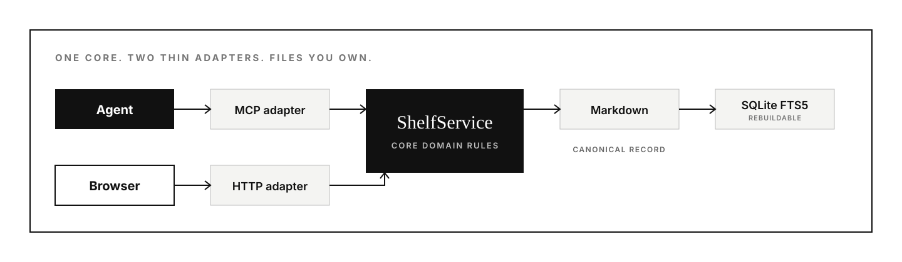

<p align="center">
  
</p>

<p align="center">
  <strong>A local, agent-native library for the writing worth keeping.</strong><br />
  Capture deterministically. Enrich with your agent. Keep everything as readable Markdown.
</p>

<p align="center">
  <a href="https://github.com/karamouche/ushelf/actions/workflows/ci.yml"></a>
  <a href="https://github.com/karamouche/ushelf/releases/latest"></a>
  <a href="LICENSE"></a>
  <a href="package.json"></a>
</p>

## Why uShelf?

Most read-later tools own the database and bolt AI onto the side. uShelf takes the opposite approach:

- **Your files are the product.** Every completed item lives as portable, readable Markdown.
- **Your agent does the thinking.** uShelf exposes an MCP server and recipe-driven workflows, not a bundled model.
- **Capture stays deterministic.** Web sources are extracted, sanitized, normalized, and checked before enrichment begins.
- **The index is disposable.** SQLite FTS5 makes the library fast to search and can always be rebuilt from Markdown.
- **Reading is first-class.** The web reader tracks inbox, reading, read, and archived states, plus scroll progress.

> uShelf includes no model SDK, AI API key, embeddings store, or autonomous LLM process.

## How it works

<p align="center">
  
</p>

1. Ask your connected agent to save something from the web or attach a PDF.
2. uShelf captures and normalizes the source with deterministic code.
3. The agent follows a versioned recipe to add cited summaries, insights, and tags.
4. You search and read everything in the web app, while the canonical record stays in Markdown.

## Quick start

Install the native CLI on macOS or Linux:

```sh
curl -fsSL https://github.com/karamouche/ushelf/releases/latest/download/install.sh | sh
```

Run uShelf on this machine with Docker, then connect the agent client you use:

```sh
ushelf start
ushelf setup claude
# or: ushelf setup codex
# or: ushelf setup all
```

Open the reader at [http://127.0.0.1:43110](http://127.0.0.1:43110), or run `ushelf open`. You can now ask the connected agent to save a URL or an attached PDF. A local library, its recipes, and its disposable index live under `~/.ushelf`.

Prefer a server that is always on? Deploy the same release-matched image anywhere and keep only the CLI and MCP bridge on your machine:

```sh
ushelf deploy ssh me@vps.example.com --domain shelf.example.com
ushelf deploy fly --app my-shelf --region cdg
```

The installer supports macOS and Linux on amd64 and arm64; Windows users can run it under WSL. Node.js, pnpm, and a repository clone are never required for normal use.

## Deploy anywhere

The uShelf server is one container that owns your library and serves the reader, the HTTP API, and the MCP endpoint. Your machine keeps the `ushelf` CLI and the `ushelf mcp` bridge, which your agent launches over stdio and which relays requests to the server over HTTPS.

```text
Agent ──stdio──> ushelf mcp (local) ──HTTPS + API token──> uShelf server ──> Markdown + SQLite
Browser ─────────────────────────────HTTPS + password────────┘
```

Each deployment is saved as a **context**. Commands act on the current context; `--context NAME` targets another one.

| Command                                         | Where it runs                     | Library storage          | HTTPS                     |
| ----------------------------------------------- | --------------------------------- | ------------------------ | ------------------------- |
| `ushelf deploy local`                           | The local Docker daemon           | `~/.ushelf` on this host | Not needed on loopback    |
| `ushelf deploy ssh USER@HOST --domain DOMAIN`   | Any Docker host reachable by SSH  | `ushelf-data` volume     | Managed Caddy certificate |
| `ushelf deploy ssh USER@HOST --url https://...` | Any Docker host reachable by SSH  | `ushelf-data` volume     | Your proxy or Tailscale   |
| `ushelf deploy fly --app APP --region REGION`   | One Fly.io Machine                | `ushelf_data` Fly volume | Provided by Fly.io        |
| `ushelf context add NAME --url https://...`     | Anywhere you deployed it yourself | Whatever you mounted     | Your responsibility       |

- **SSH targets** need Docker on the host and key-based SSH access for your user. With `--domain`, point the domain's DNS at the host and open ports 80 and 443; without it, uShelf binds to the host's loopback (or `--host`) and you provide HTTPS at `--url`.
- **Fly.io** needs `flyctl` and `fly auth login`. The Machine stops when idle and starts on the next request.
- **Your own platform** (Compose, Kubernetes, a PaaS): run the image with `USHELF_API_TOKEN` and `USHELF_APP_PASSWORD` set and a persistent volume on `/data`, then register it with `ushelf context add`.

Every deployment gets a generated **API token** that authenticates the CLI and agents. Remote deployments also require a **reader password** for the browser, read from `USHELF_APP_PASSWORD` or prompted without echo. Both are stored owner-readable in `~/.ushelf/credentials.json` and passed to the server without appearing on any command line. The CLI only sends the token over HTTPS, except to loopback addresses.

Redeploying a context keeps its saved settings and secrets unless flags override them, so `ushelf start` and `ushelf update` reconcile it in place. Moving a library between deployments is not automated yet.

### CLI reference

| Command                          | Purpose                                                                  |
| -------------------------------- | ------------------------------------------------------------------------ |
| `ushelf deploy local\|ssh\|fly`  | Create or update a deployment and make it the current context            |
| `ushelf start`                   | Reconcile the current context, or deploy locally when none exists        |
| `ushelf stop`                    | Stop the server without deleting data                                    |
| `ushelf status`                  | Show deployment state, health, URL, and server and CLI versions          |
| `ushelf logs`                    | Read or follow server logs                                               |
| `ushelf open`                    | Open the reader in the system browser                                    |
| `ushelf context list\|use\|show` | List, switch, or inspect contexts                                        |
| `ushelf context add\|remove`     | Register a self-deployed server, or forget a context                     |
| `ushelf config`                  | Inspect or change the current context's settings                         |
| `ushelf mcp`                     | Run the stdio MCP bridge to the current context                          |
| `ushelf setup CLIENT`            | Configure Codex, Claude Code, or both and link the server's skills       |
| `ushelf doctor`                  | Check the platform, deployment, server health, token, and client setup   |
| `ushelf update`                  | Verify and install the latest CLI, then roll the current context forward |
| `ushelf rebuild-index`           | Rebuild disposable SQLite state from Markdown (local and SSH)            |
| `ushelf import FILE`             | Import a validated Markdown item (local and SSH)                         |
| `ushelf kindle`                  | Connect, inspect, or disconnect Send to Kindle                           |
| `ushelf version`                 | Show CLI build and runtime image information                             |

## Connect your agent

Configure Codex, Claude Code, or both. Setup registers `ushelf mcp` at user scope, pinned to the current context so later context switches never silently retarget the agent, and links the skills published by that server into the client's personal skill directory.

```sh
ushelf setup codex
ushelf setup claude
# or: ushelf setup all
```

Use `ushelf setup <client> --print` to inspect the exact registration command without making changes. To point an agent at another deployment, switch contexts and rerun setup with `--force`.

If an existing `ushelf` MCP entry or skill path points somewhere else, setup stops without overwriting it. Inspect the conflict first, then rerun with `--force` only when you intend to replace it.

Then try:

```text
Save this URL to uShelf.
Search my uShelf for writing about local-first software.
Show me unread pieces tagged architecture.
Send the saved post about local-first software to my Kindle.
```

## Send a saved item to Kindle

Connect your Amazon account, then use **Send to Kindle** in the reader or ask your agent to send a saved item:

```sh
ushelf kindle setup
ushelf kindle status
```

The CLI opens Amazon sign-in on your machine, then uploads the resulting device credential to the current context's server, which stores it owner-readable in its `secrets/kindle.json`. The credential is not kept on your machine and is never returned by the API or MCP tools. uShelf sends a reflowable EPUB of the saved source and local images, without insights or an Amazon cloud-library copy. It remembers the last successful device; if no valid preference exists and several devices are available, the agent asks you to choose.

This unofficial integration uses Amazon's undocumented protocol through [`cyrgim/stk`](https://github.com/cyrgim/stk), which Amazon may change. Disconnect with `ushelf kindle disconnect`; add `--skip-deregister --yes` only when Amazon has already invalidated the credential.

## What is included

| Layer            | What it does                                                              |
| ---------------- | ------------------------------------------------------------------------- |
| **CLI**          | Deployment contexts, updates, agent setup, and the local MCP bridge       |
| **Core**         | Capture, validation, Markdown storage, SQLite search, and domain rules    |
| **MCP**          | Agent tools for saving, enriching, searching, reading, and managing items |
| **HTTP server**  | API, MCP endpoint, web hosting, index rebuilding, and Markdown import     |
| **Web reader**   | Search, filters, reading progress, and local Mermaid rendering            |
| **Agent skills** | Guided ingestion and library workflows                                    |

Articles use Readability. Attached PDFs use PDF.js to extract text and embedded figures; uShelf also captures local images and blocks unsafe URLs. X has limited public extraction, with agent-supplied fallback content.

PDF attachments must be at most 10 MiB and contain embedded text. Remote PDF URLs, OCR, vector-diagram reconstruction, complex multi-column layouts, DOCX, and PPTX are unsupported.

## Markdown at the core

A local deployment keeps these paths under `~/.ushelf`; remote deployments keep the same layout inside their data volume.

| Path                         | Purpose                                               |
| ---------------------------- | ----------------------------------------------------- |
| `~/.ushelf/library/items/`   | Canonical current Markdown documents                  |
| `~/.ushelf/library/history/` | Archived enrichment revisions                         |
| `~/.ushelf/library/files/`   | Original PDFs and content-addressed item media        |
| `~/.ushelf/recipes/`         | Editable, hash-versioned agent instructions           |
| `~/.ushelf/state/ushelf.db`  | Rebuildable search index and transient workflow state |
| `~/.ushelf/secrets/`         | Owner-readable optional integration credentials       |

Markdown remains the source of truth. Canonical URLs deduplicate web ingestion, original-file hashes deduplicate PDF ingestion, content hashes detect source changes, recipe hashes identify stale enrichment, and revisions protect concurrent updates. If the index disappears, restore it with:

```sh
ushelf rebuild-index
```

To import an externally edited validated Markdown item, run:

```sh
ushelf import /absolute/path/to/item.md
```

Rendered images are downloaded into `library/files/<item-id>/media/` and referenced from canonical Markdown with portable relative paths. The reader serves only those validated local assets and never loads remote Markdown images. Retained PDFs can be opened from their document reader; embedded raster figures are extracted into the page-ordered Markdown, which remains the canonical searchable record.

## Run continuously with Docker Compose

Compose builds the API and reader into one container. It restarts automatically and stores your library on the host.

```sh
cp .env.example .env
printf 'USHELF_UID=%s\nUSHELF_GID=%s\n' "$(id -u)" "$(id -g)" >> .env
mkdir -p "$HOME/.ushelf/library/items" "$HOME/.ushelf/library/history" \
  "$HOME/.ushelf/recipes" "$HOME/.ushelf/state" "$HOME/.ushelf/secrets"
chmod 700 "$HOME/.ushelf/secrets"
test -f "$HOME/.ushelf/recipes/default.md" || \
  cp recipes/default.md "$HOME/.ushelf/recipes/default.md"
docker compose up -d --build
docker compose ps
```

Compose uses `~/.ushelf` by default. To use another location, set an absolute `USHELF_ROOT` in `.env` and create the same directories there. Set `USHELF_UID` and `USHELF_GID` to your host IDs so containers can access the files.

To connect agents and the CLI, set `USHELF_API_TOKEN` in `.env` (for example `openssl rand -base64 32`), then register the server; the CLI prompts for the token without echo:

```sh
ushelf context add compose --url http://127.0.0.1:43110
ushelf setup claude
ushelf kindle setup
```

The service binds to `127.0.0.1:43110` by default. For password protection, set `USHELF_APP_PASSWORD` in `.env`. It covers the API, PDFs, media, and reader for browser sessions; sign-in and the content-free health check remain public. Requests carrying the API token bypass the browser session, and the MCP endpoint and administrative routes accept only the token. Do not expose a service without both secrets to the internet.

For remote access, use an HTTPS reverse proxy, keep uShelf bound to loopback, and forward the original `Host` header. Sign-in uses a Secure cookie that expires after 12 hours or on server restart or password change. Neither secret protects Docker or filesystem access on the host.

If a proxy or CDN previously cached uShelf responses, purge its cache before enabling the password, especially `/api/items/*/media/*`, and disable caching of protected responses. Older versions allowed year-long media caches that a password change cannot revoke. Current media responses use `Cache-Control: no-store`.

The image defaults to UID/GID `1000:1000`; Compose uses the IDs in `.env`.

Common operations:

```sh
docker compose logs -f ushelf
docker compose restart ushelf
docker compose down

git pull
docker compose up -d --build
```

To rebuild the disposable index against the same bind mounts:

```sh
docker compose stop ushelf
docker compose run --rm --no-deps maintenance rebuild-index
docker compose up -d
```

For a consistent backup, stop the service and copy `library/` and `recipes/`. Copy `secrets/` if you want to keep integration credentials. SQLite state is rebuildable.

### Configuration

| Variable               | Default                 | Purpose                                                          |
| ---------------------- | ----------------------- | ---------------------------------------------------------------- |
| `USHELF_ROOT`          | `~/.ushelf`             | Root containing `library/`, `recipes/`, `state/`, and `secrets/` |
| `USHELF_STATE_DIR`     | `<USHELF_ROOT>/state`   | Optional override for disposable SQLite state                    |
| `USHELF_HOST`          | `127.0.0.1`             | Address published by the HTTP server or Compose                  |
| `USHELF_PORT`          | `43110`                 | HTTP port                                                        |
| `USHELF_WEB_BASE_PATH` | `/`                     | Root or subpath where the web app and API are served             |
| `USHELF_APP_PASSWORD`  | unset                   | Optional password for browser access to library content          |
| `USHELF_API_TOKEN`     | unset                   | Bearer token for the CLI, agents, and the `/mcp` endpoint        |
| `USHELF_SECRETS_DIR`   | `<USHELF_ROOT>/secrets` | Optional override for integration credentials                    |

Without path overrides, host processes use `~/.ushelf` and keep `library/`, `recipes/`, `state/`, and `secrets/` directly beneath it. The service creates the writable directories it needs and seeds the bundled default recipe when it is missing. The `secrets/` directory remains optional until an integration is configured.

Set `USHELF_ROOT` to move the complete layout. Use `USHELF_STATE_DIR` or `USHELF_SECRETS_DIR` only when either directory must live outside that root. Containers use `/data` internally, backed by the selected host root.

The native CLI keeps its own files in `~/.ushelf` (`config.json`, `credentials.json`, and downloaded agent assets); `--home` or `USHELF_ROOT` moves them. `--context` or `USHELF_CONTEXT` selects a context for one command. Use `ushelf config show` for the current context's effective settings and `ushelf config set` to change its image, base path, host, port, domain, URL, region, or app password, then run `ushelf start` to apply them. The password is prompted without echo, and `config show` reports secrets only as `configured` or `unset`.

For a subpath deployment, use an absolute path such as `/reader/`. uShelf normalizes the trailing slash, and your reverse proxy must preserve the prefix.

## Repository map

```text
packages/core   Shared domain and storage layer
apps/cli        Native Cobra CLI, deployment drivers, and MCP bridge
apps/server     HTTP and CLI adapter
apps/mcp        MCP tool surface hosted by the server
apps/web        React and Vite reader
recipes         Versioned enrichment instructions
skills          Agent ingestion and library workflows
library         Canonical saved documents and history
```

Package-specific runtime notes live in the README inside each package.

## Development

Contributors need Node.js 24+, pnpm 11, Go 1.25+, and Docker.

```sh
git clone https://github.com/karamouche/ushelf.git
cd ushelf
pnpm install
cp .env.example .env
pnpm dev
```

```sh
pnpm typecheck
pnpm test
pnpm build
pnpm test:e2e
pnpm format:check
pnpm validate:skills
pnpm db:check
go -C apps/cli vet ./...
```

When changing the SQLite schema, edit the Drizzle schema in Core, run `pnpm db:generate --name=describe_the_change`, and review the checked-in SQL migration.

Run the smallest relevant check while iterating. Build before `pnpm test:e2e`, because Playwright launches the compiled production server.
The E2E command also performs live ingestion checks against the documented X and article fixtures, so it requires internet access and can fail when either upstream source is unavailable or changes its public metadata.

Contributions should preserve the central boundary: deterministic code captures and stores sources; a connected agent performs explicit, recipe-driven enrichment. See [CONTRIBUTING.md](CONTRIBUTING.md) for the contribution license terms.

## Releasing

Run the **Release** workflow manually with the desired semantic version. The workflow opens a `release/vMAJOR.MINOR.PATCH` pull request containing the project-version updates. Merging that pull request verifies the merged commit, creates its version tag, publishes the CLI archives and container image, and creates the GitHub Release. Do not create the release tag beforehand.

## License

uShelf is licensed under the [Apache License 2.0](LICENSE).
