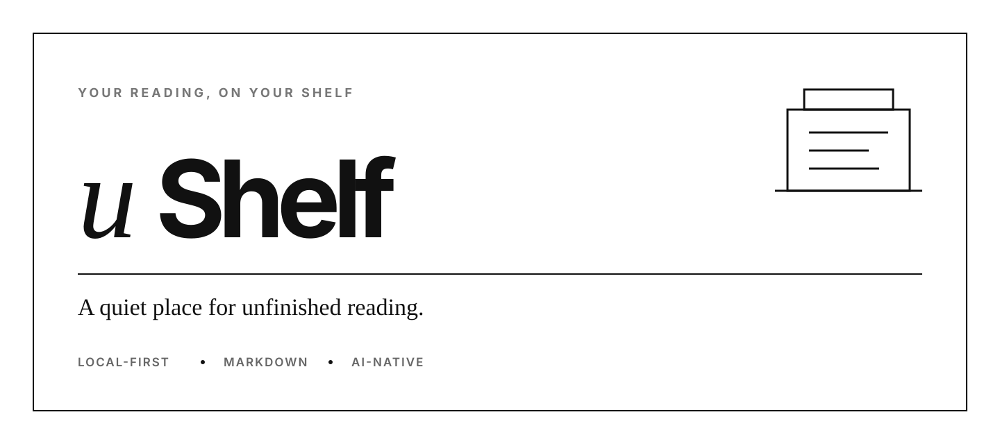

<p align="center">
  
</p>

<p align="center">
  <strong>A local, agent-native library for the writing worth keeping.</strong><br />
  Capture deterministically. Enrich with your agent. Keep everything as readable Markdown.
</p>

<p align="center">
  <a href="https://github.com/karamouche/ushelf/actions/workflows/ci.yml"></a>
  <a href="https://github.com/karamouche/ushelf/releases/latest"></a>
  <a href="https://karamouche.github.io/ushelf/"></a>
  <a href="LICENSE"></a>
  <a href="package.json"></a>
</p>

## Why uShelf?

Most read-later tools own the database and bolt AI onto the side. uShelf takes the opposite approach:

- **Your files are the product.** Every completed item lives as portable, readable Markdown.
- **Your agent does the thinking.** uShelf exposes an MCP server and recipe-driven workflows, not a bundled model.
- **Capture stays deterministic.** Web sources are extracted, sanitized, normalized, and checked before enrichment begins.
- **The index is disposable.** SQLite FTS5 makes the library fast to search and can always be rebuilt from Markdown.
- **Deploy where you like.** Run the server locally, on any Docker host over SSH, on Fly.io, or on your own platform; the CLI and MCP bridge stay on your machine.
- **Bring any agent.** Local agents use the MCP bridge; Claude (web, desktop, mobile) and ChatGPT connect to a deployed server as [OAuth connectors](https://karamouche.github.io/ushelf/agents/claude-and-chatgpt/).

> uShelf includes no model SDK, AI API key, embeddings store, or autonomous LLM process.

<p align="center">
  
</p>

## Quick start

Install the CLI on macOS or Linux (or WSL), then run a local library with Docker and connect your agent:

```sh
curl -fsSL https://github.com/karamouche/ushelf/releases/latest/download/install.sh | sh
ushelf start
ushelf setup claude   # or: codex, all
```

Open the reader with `ushelf open`, then ask your agent to save a URL or an attached PDF.

To keep the server always on, deploy it elsewhere instead:

```sh
ushelf deploy ssh me@vps.example.com --domain ushelf.example.com
ushelf deploy fly --app my-ushelf --region cdg
```

## Documentation

Everything else lives at **[karamouche.github.io/ushelf](https://karamouche.github.io/ushelf/)**:

- [Installation](https://karamouche.github.io/ushelf/getting-started/installation/) and [quick start](https://karamouche.github.io/ushelf/getting-started/quick-start/)
- [Deploy anywhere](https://karamouche.github.io/ushelf/deploy/overview/): [local](https://karamouche.github.io/ushelf/deploy/local/), [SSH](https://karamouche.github.io/ushelf/deploy/ssh/), [Fly.io](https://karamouche.github.io/ushelf/deploy/fly/), [self-hosted and Compose](https://karamouche.github.io/ushelf/deploy/self-hosted/), and the [security model](https://karamouche.github.io/ushelf/deploy/security/)
- [Connect an agent](https://karamouche.github.io/ushelf/agents/connect/) over the stdio bridge or direct HTTP, and [skills and recipes](https://karamouche.github.io/ushelf/agents/skills-and-recipes/)
- [Library and storage](https://karamouche.github.io/ushelf/concepts/library/), [Send to Kindle](https://karamouche.github.io/ushelf/guides/kindle/), and [maintenance and backups](https://karamouche.github.io/ushelf/guides/maintenance/)
- Reference: [CLI](https://karamouche.github.io/ushelf/reference/cli/), [configuration](https://karamouche.github.io/ushelf/reference/configuration/), [MCP tools](https://karamouche.github.io/ushelf/reference/mcp/), and [HTTP API](https://karamouche.github.io/ushelf/reference/http-api/)

The site's source is in [`apps/docs`](apps/docs); preview it locally with `pnpm docs:dev`.

## Development

Contributors need Node.js 24.22.1+ (or 26.12.1+), pnpm 11, Go 1.26.10+ (or 1.27.3+), and Docker:

```sh
pnpm install
cp .env.example .env
pnpm dev
```

See [CONTRIBUTING.md](CONTRIBUTING.md) for the checks, the agent setup against a dev server, and the contribution license terms. The repository's [`AGENTS.md`](AGENTS.md) describes the engineering rules, and each package has its own README.

## License

uShelf is licensed under the [Apache License 2.0](LICENSE).
