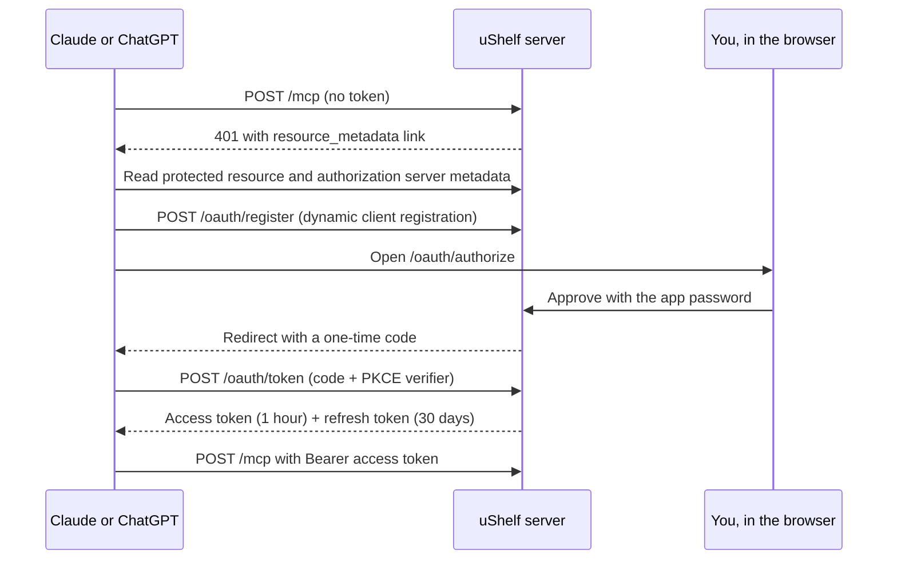

Claude on the web, desktop, and mobile, and ChatGPT, can use your library as a **custom connector**. These apps run in their vendor's cloud, so they cannot launch `ushelf mcp` or hold your API token. Instead they connect to the server's `/mcp` endpoint over the internet and sign in with OAuth. You approve each app once with your app password, and you can revoke it at any time.

## Requirements

- A **remote deployment with a public HTTPS URL**: [Fly.io](../../deploy/fly/), a [Docker host over SSH](../../deploy/ssh/) with a domain, or a [self-hosted](../../deploy/self-hosted/) server behind a TLS proxy. A local deployment listens only on loopback, which the vendors' clouds cannot reach.
- An **app password**. Remote deployments made by the CLI always have one. OAuth is turned off on servers without a password, because the password is how you approve a connector.
- A plan that allows custom connectors. On Claude Team and Enterprise plans, an owner may need to add the connector for the organization. On ChatGPT, custom connectors need developer mode. Check each vendor's current plan details.

## Find the connector URL

```sh
ushelf connectors
```

The first line is the URL to paste, for example `https://ushelf.example.com/mcp`. It is the context URL followed by `mcp`, including any base path.

## Add the connector

### Claude

1. In Claude on the web or desktop, open **Settings → Connectors** and choose **Add custom connector**.
2. Name it `uShelf` and paste the connector URL. Leave the OAuth client ID and secret empty: Claude registers itself.
3. Choose **Connect**. A uShelf page opens (see [Approve the connection](#approve-the-connection)).

Connectors added on the web or desktop also work in the Claude mobile apps on the same account. Enable uShelf for a chat from the tools menu in the composer.

### ChatGPT

1. In ChatGPT settings, open **Apps & Connectors**, then **Advanced settings**, and turn on **Developer mode**.
2. Create a connector, paste the connector URL, and choose **OAuth** as the authentication method. Leave the client credentials empty: ChatGPT registers itself.
3. Confirm, then sign in when prompted. A uShelf page opens (see [Approve the connection](#approve-the-connection)).

The ChatGPT settings change often. If these labels are different, look for the developer-mode option for custom MCP connectors.

### Other MCP clients

Any client that implements the [MCP authorization specification](https://modelcontextprotocol.io/specification/2025-06-18/basic/authorization) can connect the same way. Clients on your own machine should still prefer the [stdio bridge](../connect/#stdio-bridge).

## Approve the connection

The uShelf consent page shows:

- the name the app gave itself;
- **the address it will return to**, such as `claude.ai` or `chatgpt.com`. Check this before you approve. The name is chosen by the app, but the return address decides where access is sent;
- a warning when the app runs on a computer rather than a hosted service (a loopback address). Continue only if you started that connection yourself.

Enter your app password and choose **Allow access**. The app returns to its own page and lists the uShelf tools. **Deny** sends it back without access.

Password attempts on this page and on the reader's sign-in page share one rate limit. While it is active, even the correct password is refused until the minute is up.

## What a connector can do

A connector has the same [MCP tools](../../reference/mcp/) as a local agent. It can search, read, save, edit, refresh, and delete items, and send them to Kindle. Permanent deletion still requires the two-step `request_delete` / `confirm_delete` flow. A connector cannot use the browser or administrative API routes, such as Kindle credentials or connector management.

### Skills

Connectors receive the tools but not the [uShelf skills](../skills-and-recipes/), which guide the ingestion and library workflows. The apps work without them, but enrichment follows the recipes most closely with the skills installed. Where the app supports skills, upload the `ushelf-ingest` and `ushelf-library` folders from `~/.ushelf/assets/skills/` (created by `ushelf setup`) or from the repository's `skills/` directory. In Claude, upload them under **Settings → Capabilities**.

## Manage connectors

```sh
ushelf connectors                    # list authorized apps and when they were last used
ushelf connectors revoke CLIENT_ID   # disconnect one app immediately
ushelf connectors revoke --all       # disconnect every app
```

Revoking deletes the app's registration and tokens. The app must be connected again, with the password, to regain access. Removing the connector in Claude or ChatGPT does not always notify the server, so revoke it here too.

Changing the app password does **not** disconnect existing connectors. To cut off every app, for example after a suspected leak, run `ushelf connectors revoke --all`. Grants are also lost if the SQLite state is deleted. The library is unaffected, but every app must reconnect.

## How it works

uShelf's server is its own OAuth 2.1 authorization server. Nothing is delegated to a third-party identity provider.



- **Discovery:** an unauthenticated `/mcp` request returns `401` with a `WWW-Authenticate` header that points to the [protected resource metadata](https://www.rfc-editor.org/rfc/rfc9728) under the base path. Authorization server metadata ([RFC 8414](https://www.rfc-editor.org/rfc/rfc8414)) is served there and at the standard root `/.well-known/` locations.
- **Registration:** apps register through [dynamic client registration](https://www.rfc-editor.org/rfc/rfc7591), as public clients or as confidential clients with a secret. Redirect addresses must use HTTPS, or HTTP on a loopback address, and must match exactly; loopback addresses match on any port. Registrations that never complete a connection are discarded after a day.
- **Authorization:** only the authorization-code flow with S256 [PKCE](https://www.rfc-editor.org/rfc/rfc7636) is accepted. Codes are single-use and expire after two minutes. The redirect includes the `iss` parameter.
- **Tokens:** access tokens last one hour and are accepted only on `/mcp`. Refresh tokens last 30 days and rotate on every use. Presenting a rotated-out refresh token revokes the whole connection, because it signals a leaked or replayed token. Apps can revoke tokens themselves through the [RFC 7009](https://www.rfc-editor.org/rfc/rfc7009) endpoint.
- **Storage:** the server stores only SHA-256 digests of client secrets, codes, and tokens, in the SQLite state.
- **Public URL:** the server builds its metadata URLs from the request's `Host` header and `X-Forwarded-Proto`, so they match the URL you pasted behind Caddy, Fly.io, or another TLS proxy. Self-hosted proxies must forward both headers.

The static API token keeps working on `/mcp`, so the stdio bridge and direct HTTP clients are unaffected.

## Troubleshooting

| Symptom                                                        | Check                                                                                                                                                                                             |
| -------------------------------------------------------------- | ------------------------------------------------------------------------------------------------------------------------------------------------------------------------------------------------- |
| "Couldn't reach the MCP server" or the app never shows sign-in | The URL must be public HTTPS and end in `/mcp`. `curl -i https://…/mcp -X POST` must return `401` with a `resource_metadata` link. Without an app password, OAuth is off and the link is missing. |
| The consent page says the connector is not registered          | The registration was revoked or discarded. Start the connection again from the app.                                                                                                               |
| Metadata URLs show `http://` or an internal host               | Your proxy does not forward `Host` or `X-Forwarded-Proto`. Fix the proxy configuration.                                                                                                           |
| "Too many attempts"                                            | Ten wrong passwords within a minute pause sign-in and approval, even with the correct password, until the minute is up.                                                                           |
| The app asks to reconnect                                      | Its refresh token expired after 30 days without use, was revoked, or was replayed.                                                                                                                |
