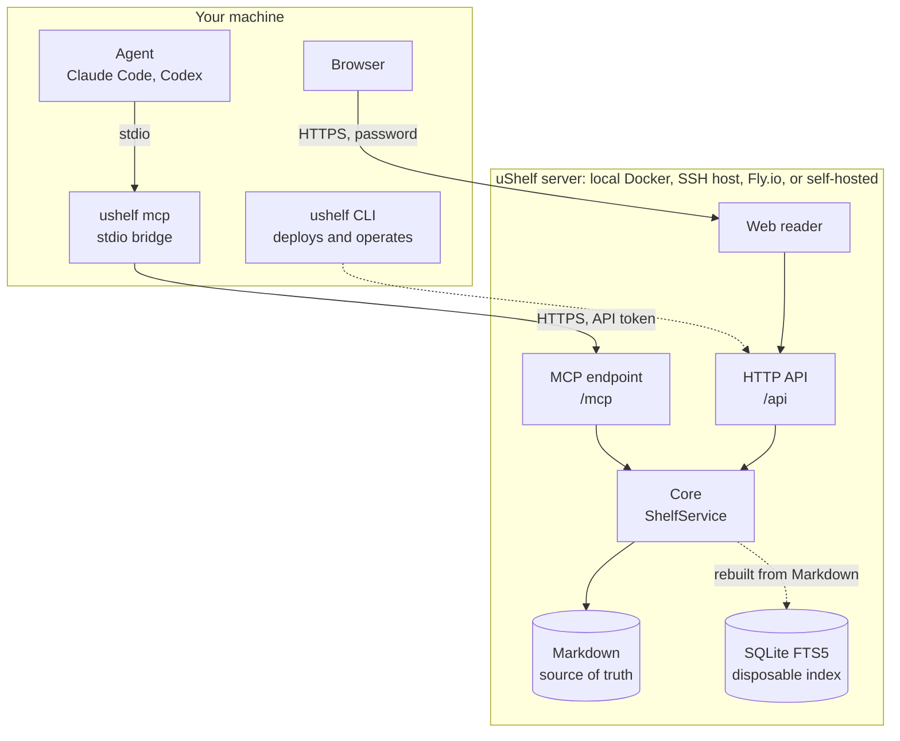

uShelf separates what runs on your machine from where your library lives.



- **The server** is one container. It owns the library and serves the web reader, the HTTP API, and the MCP endpoint at `/mcp`. Exactly one server process writes a given library.
- **The CLI** (`ushelf`) deploys and operates servers, stores their connection details as [contexts](../../deploy/overview/#contexts), and configures agent clients.
- **The MCP bridge** (`ushelf mcp`) is a small local process that agents launch over stdio. It relays each MCP message to the server over HTTPS with the context's API token. Agents can also [connect over HTTP directly](../../agents/connect/#direct-http).

## Components

| Layer            | What it does                                                              |
| ---------------- | ------------------------------------------------------------------------- |
| **CLI**          | Deployment contexts, updates, agent setup, and the local MCP bridge       |
| **Core**         | Capture, validation, Markdown storage, SQLite search, and domain rules    |
| **MCP**          | Agent tools for saving, enriching, searching, reading, and managing items |
| **HTTP server**  | API, MCP endpoint, web hosting, index rebuilding, and Markdown import     |
| **Web reader**   | Search, filters, reading progress, and local Mermaid rendering            |
| **Agent skills** | Guided ingestion and library workflows                                    |

The HTTP and MCP adapters are thin: both delegate to `ShelfService` in Core, so business rules exist in one place.

## Repository map

```text
packages/core   Shared domain and storage layer
apps/cli        Native Cobra CLI, deployment drivers, and MCP bridge
apps/server     HTTP and CLI adapter, MCP endpoint host
apps/mcp        MCP tool surface hosted by the server
apps/web        React and Vite reader
apps/docs       This documentation site
recipes         Versioned enrichment instructions
skills          Agent ingestion and library workflows
```

Each package has a README with its runtime details. See [CONTRIBUTING.md](https://github.com/karamouche/ushelf/blob/main/CONTRIBUTING.md) to work on the code.
